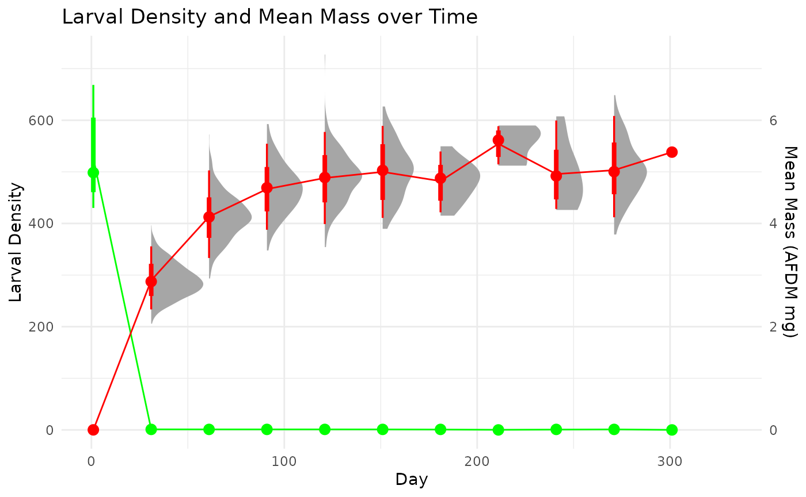
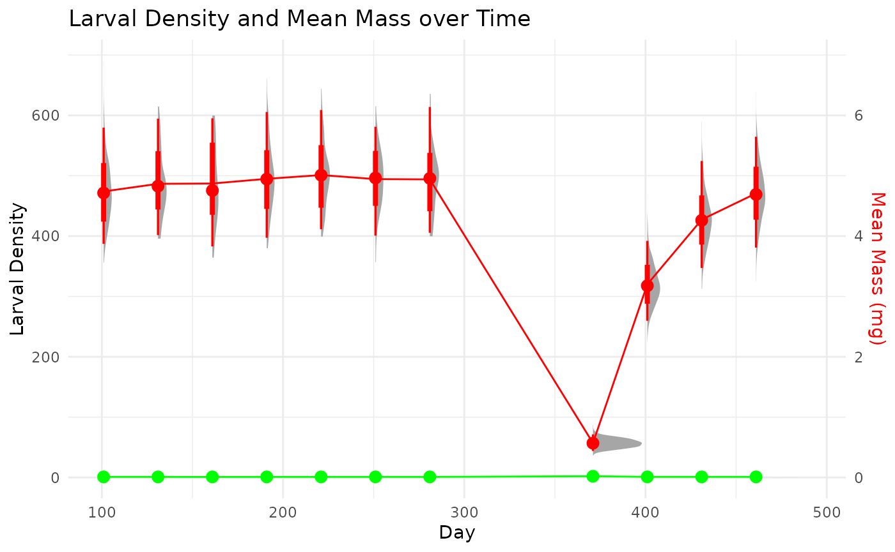
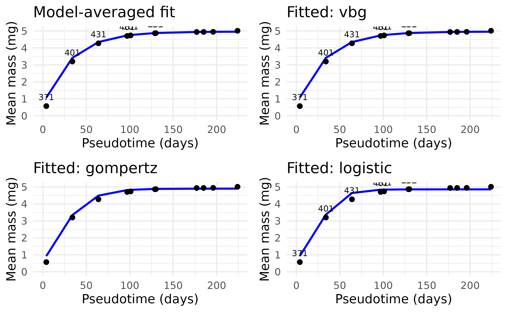

# Simulating the sampling of populations

## Purpose

This document outlines the process for simulating the sampling of
populations for developing and testing models of secondary production.
These processes were used to simulate data for the examples used in the
model tutorials.

## Simulation process

The data generation process for each data set is based on a simulated
grid based on a number of parameters that control the sampling area,
distribution of individuals, growth and mortality parameters of the
populations, etc. (Table 1).

| Parameters | Description |
|:---|:---|
| grid_size | The grid dimension of the ‘x’ and ‘y’ direction. Total grid cells is $`n^2`$ |
| mu_N_init | The mean initial density of the grid cells. Values are randomly drawn from a $`N(mu_{Ninit}, sigma_{Ninit})`$ |
| sigma_N_init | The standard deviation of initial density of grid cells. Values are randomly drawn from $`N(mu_{Ninit}, sigma_{Ninit})`$ |
| initial_mass | The initial mass of all individuals. |
| mu_ln | The mean asymptotic mass of von Bertalanffy growth. Values for each individual are randomly draws from $`Lognormal(mu_{ln}, sigma_{ln})`$. |
| sigma_ln | The standard deviation of asymptotic mass of von Bertalanffy growth. Values for each individual are randomly draws from $`Lognormal(mu_{ln}, sigma_{ln})`$. |
| mu_z | The mean mortality rate for a negative exponential model. Values for each cell are randomly drawn from $`N(mu_{z}, sigma_{z})`$. |
| sigma_z | The standard devation in mortality rate for a negative exponential model. Values for each cell are randomly drawn from $`N(mu_{z}, sigma_{z})`$. |
| cpi_start | The lower end of the cohort production interval. This is used to modify the growth coefficient, $`k`$, in von Bertalanffy growth. Values for each individual are drawn $`Uniform(cpi_{start}, cpi_{end})`$. |
| cpi_end | The upper end of the cohort production interval.This is used to modify the growth coefficient, $`k`$, in von Bertalanffy growth. Values for each individual are drawn $`Uniform(cpi_{start}, cpi_{end})`$. |
| days | The number of days to simulate. |
| sample_interval | The interval in days between sampling events. |
| sample_start | The start date (1:days) for the first sampling event. |
| sample_end | The end date (sample_start:days) for the last sampling event. |
| S | The number of sample replicates to take at each sampling event. Samples are chosen without replacement within a sampling event. |

### Single cohort

We first simulate a single cohort from the following parameters. The
individuals all have the same initial mass. Each individual grows based
on a von Bertalanffy growth model with a randomly drawn asymptotic mass,
$`M_{inf}`$, and the growth coefficient, $`k`$, is calculated by a
randomly drawn lifespan (CPI) determined by user-defined inputs. Once an
individual reaches $`M_{inf}`$ it transitions to an ‘adult’ and is no
longer counted in samples. Mortality is governed in each grid cell by a
randomly draw death rate, $`z`$, from a negative exponential model.

``` r

# Parameters
grid_size <- 20
mu_N_init <- 500
sigma_N_init <- 100
initial_mass <- 0.0006
mu_ln <- log(5^2 / sqrt(0.5^2 + 5^2)) # mean of ~5 mg in Normal(mu, sigma)
sigma_ln <- sqrt(log(1 + (0.5^2 / 5^2))) #sd of ~0.5mg Normal(mu, sigma)
mu_z <- 0.04
sigma_z <- 0.01
cpi_start <- 290
cpi_end <- 310
days <- 506
sample_interval <- 30
sample_start <- 1    
sample_end <- 365    
S <- 10  
```

Click below to see the code to simulate a single cohort.

``` r

## not run
# Function to initialize a cohort
init_cohort <- function(i, j, start_day) {
  N_init <- max(1, round(rnorm(1, mu_N_init, sigma_N_init)))
  M_inf <- rlnorm(N_init, meanlog = mu_ln, sdlog = sigma_ln)
  k <- log(M_inf / initial_mass) / runif(N_init, cpi_start, cpi_end)
  z <- rnorm(1, mu_z, sigma_z)
  tibble(
    x = i,
    y = j,
    id = 1:N_init,
    mass = initial_mass,
    M_inf = M_inf,
    k = k,
    alive = TRUE,
    adult = FALSE,
    z = z,
    cohort_start = start_day
  )
}

# Initialize first cohort on day 1
grid_population <- map2_dfr(rep(1:grid_size, each = grid_size), rep(1:grid_size, times = grid_size), ~init_cohort(.x, .y, 1))

# Daily update function for larval individuals only
update_day <- function(pop, current_day) {
  pop %>%
    dplyr::filter(alive & !adult) %>%
    dplyr::mutate(
      time_since_start = current_day - cohort_start,
      alive = runif(n()) > z,
      mass = M_inf * (1 - exp(-k * time_since_start)),
      adult = mass >= M_inf
    ) %>%
    dplyr::filter(alive & !adult)  # remove those who died or became adult
}

# Run simulation with second cohort added at day 366
simulation <- vector("list", length = days)
simulation[[1]] <- grid_population

set.seed(1312)
for (d in 2:days) {
  updated_pop <- update_day(simulation[[d - 1]], d - 1)

  if (d == 366) {
    new_cohort <- map2_dfr(rep(1:grid_size, each = grid_size), rep(1:grid_size, times = grid_size), ~init_cohort(.x, .y, 366))
    updated_pop <- bind_rows(updated_pop, new_cohort)
  }
  simulation[[d]] <- updated_pop
}

# Combine for sampling
all_days <- bind_rows(simulation, .id = "day") %>%
  dplyr::mutate(day = as.integer(day))

# Sampling protocol (larvae only)
sampling_results <- list()
sampled_cells <- list()

for (t in seq(sample_start, sample_end, by = sample_interval)) {
  all_cells <- expand.grid(x = 1:grid_size, y = 1:grid_size)
  if (length(sampled_cells) > 0) {
    prev_sampled <- bind_rows(sampled_cells)
    available_cells <- anti_join(all_cells, prev_sampled, by = c("x", "y"))
  } else {
    available_cells <- all_cells
  }
  sampled <- available_cells %>% sample_n(min(S, nrow(available_cells)))
  sampled_cells[[length(sampled_cells) + 1]] <- sampled

  sampled_data <- all_days %>%
    dplyr::filter(day == t) %>%
    semi_join(sampled, by = c("x", "y")) %>%
    group_by(x, y) %>%
    summarise(
      larval_density = n(),
      mass_distribution = list(mass),
      .groups = "drop"
    ) %>%
    dplyr::mutate(day = t)

  sampling_results[[length(sampling_results) + 1]] <- sampled_data
}

# Final output
## clean to consistent naming
daily_sampling <- bind_rows(sampling_results) %>%
  dplyr::mutate(taxonID = 'sppX', repID = 1:n(), .by = c('day')) %>%
  rename(density = larvalDensity, mass = massDistribution, dateID = day)

zeroFills = expand.grid(taxonID = 'sppX',
                        dateID = unique(daily_sampling$dateID),
                        repID = 1:10,
                        density = 0, mass = NA)

daily_sampling = daily_sampling %>%
  select(-x,-y) %>%
  full_join(.,zeroFills, by = c('taxonID','dateID','repID')) %>%
  mutate(density = ifelse(is.na(density.x), density.y, density.x),
         mass = ifelse(is.na(mass.x), mass.y, mass.x)) %>%
  select(taxonID, dateID, repID, density, mass)
```

#### Load, summarise, and visualize the simulated sampling data



### A split cohort

This example explore the options to calculate production of a univoltine
population when sampling starts in the middle of a cohort and ends by
sampling a different cohort. This event may not be ideal, but is very
common. We operate under the assumption that the life-history
characteristics and environment, generally, are similar among cohorts.
This may or may not be an acceptable assumption depending on the
specific conditions.

To see the code to produce the simulated data set click below

``` r

# Spatial growth and mortality simulation in R
library(dplyr)
library(tidyr)
library(purrr)
library(ggplot2)
library(ggdist)

# Parameters
grid_size <- 20
mu_N_init <- 500
sigma_N_init <- 100
initial_mass <- 0.0006
mu_ln <- log(5^2 / sqrt(0.5^2 + 5^2))
sigma_ln <- sqrt(log(1 + (0.5^2 / 5^2)))
mu_z <- 0.04
sigma_z <- 0.01
cpi_start <- 290
cpi_end <- 310
days <- 506
sample_interval <- 30
sample_start <- 101    # adjustable start day
sample_end <- 465    # adjustable end day
S <- 10  # number of cells to sample per event

# Function to initialize a cohort
init_cohort <- function(i, j, start_day) {
  N_init <- max(1, round(rnorm(1, mu_N_init, sigma_N_init)))
  M_inf <- rlnorm(N_init, meanlog = mu_ln, sdlog = sigma_ln)
  k <- log(M_inf / initial_mass) / runif(N_init, cpi_start, cpi_end)
  z <- rnorm(1, mu_z, sigma_z)
  tibble(
    x = i,
    y = j,
    id = 1:N_init,
    mass = initial_mass,
    M_inf = M_inf,
    k = k,
    alive = TRUE,
    adult = FALSE,
    z = z,
    cohort_start = start_day
  )
}

# Initialize first cohort on day 1
set.seed(1312)

grid_population <- map2_dfr(rep(1:grid_size, each = grid_size), rep(1:grid_size, times = grid_size), ~init_cohort(.x, .y, 1))

# Daily update function for larval individuals only
update_day <- function(pop, current_day) {
  pop %>%
    dplyr::filter(alive & !adult) %>%
    dplyr::mutate(
      time_since_start = current_day - cohort_start,
      alive = runif(n()) > z,
      mass = M_inf * (1 - exp(-k * time_since_start)),
      adult = mass >= M_inf
    ) %>%
    dplyr::filter(alive & !adult)  # remove those who died or became adult
}

# Run simulation with second cohort added at day 366
simulation <- vector("list", length = days)
simulation[[1]] <- grid_population

#set seed to reproduce
for (d in 2:days) {
  updated_pop <- update_day(simulation[[d - 1]], d - 1)

  if (d == 366) {
    new_cohort <- map2_dfr(rep(1:grid_size, each = grid_size), rep(1:grid_size, times = grid_size), ~init_cohort(.x, .y, 366))
    updated_pop <- bind_rows(updated_pop, new_cohort)
  }
  simulation[[d]] <- updated_pop
}

# Combine for sampling
all_days <- bind_rows(simulation, .id = "day") %>%
  dplyr::mutate(day = as.integer(day))

# Sampling protocol (larvae only)
sampling_results <- list()
sampled_cells <- list()

for (t in seq(sample_start, sample_end, by = sample_interval)) {
  all_cells <- expand.grid(x = 1:grid_size, y = 1:grid_size)
  if (length(sampled_cells) > 0) {
    prev_sampled <- bind_rows(sampled_cells)
    available_cells <- anti_join(all_cells, prev_sampled, by = c("x", "y"))
  } else {
    available_cells <- all_cells
  }
  sampled <- available_cells %>% sample_n(min(S, nrow(available_cells)))
  sampled_cells[[length(sampled_cells) + 1]] <- sampled

  sampled_data <- all_days %>%
    dplyr::filter(day == t) %>%
    semi_join(sampled, by = c("x", "y")) %>%
    group_by(x, y) %>%
    summarise(
      larvalDensity = n(),
      massDistribution = list(mass),
      .groups = "drop"
    ) %>%
    dplyr::mutate(day = t)

  sampling_results[[length(sampling_results) + 1]] <- sampled_data
}

# Final output
## clean to consistent naming
daily_sampling <- bind_rows(sampling_results)%>%
  dplyr::mutate(taxonID = 'sppX', repID = 1:n(), .by = c('day')) %>%
  rename(density = larvalDensity, mass = massDistribution, dateID = day)

zeroFills = expand.grid(taxonID = 'sppX',
                        dateID = unique(daily_sampling$dateID),
                        repID = 1:10,
                        density = 0, mass = NA)

daily_sampling = daily_sampling %>%
  select(-x,-y) %>%
  full_join(.,zeroFills, by = c('taxonID','dateID','repID')) %>%
  mutate(density = ifelse(is.na(density.x), density.y, density.x),
         mass = ifelse(is.na(mass.x), mass.y, mass.x)) %>%
  select(taxonID, dateID, repID, density, mass)
```

#### Load, summarise, and visualize the simulated sampling data



#### Remapping a split cohort to a single analysis

In order to perform a full cohort analysis on a cohort that is split in
time, we can ‘remap’ the two cohorts into a new timescale that follows a
consistent cohort progression. We can then calculate production through
regular cohort methods. If we need to extract time-specific values, we
can simply map the estimates back to the original time scale.

We developed a quick algorithm to automate the determination of the
beginning and ends of a *non-overlapping* cohort.

This function reorders the sampling events to follow a continuous growth
progression. This allows for the determination of model-based estimates
of cohort production and associated growth statistics and also keeps the
information to re-map the production outputs to the original sampling
times.

    #> $df_remap
    #> # A tibble: 11 × 5
    #>    dateID mean_mass cohort pseudo_day pseudotime
    #>     <dbl>     <dbl>  <dbl>      <dbl>      <dbl>
    #>  1    371     0.571      1        0            4
    #>  2    401     3.20       1       30           34
    #>  3    431     4.27       1       60           64
    #>  4    461     4.71       1       90           97
    #>  5    101     4.74       2       95.2        101
    #>  6    131     4.87       2      125.         129
    #>  7    161     4.87       2      155.         130
    #>  8    281     4.94       2      275.         177
    #>  9    251     4.94       2      245.         185
    #> 10    191     4.95       2      185.         196
    #> 11    221     5.01       2      215.         224
    #> 
    #> $offset
    #> [1] 95.15894
    #> 
    #> $weights
    #>          vbg     gompertz     logistic 
    #> 9.999941e-01 5.854241e-06 1.168372e-08 
    #> 
    #> $fits
    #> $fits$vbg
    #> Nonlinear regression model
    #>   model: W_all ~ Winf * (1 - exp(-k * (t_all - t0)))
    #>    data: parent.frame()
    #>     Winf        k       t0 
    #>  4.96028  0.03079 -3.94332 
    #>  residual sum-of-squares: 0.007516
    #> 
    #> Number of iterations to convergence: 6 
    #> Achieved convergence tolerance: 5.922e-07
    #> 
    #> $fits$gompertz
    #> Nonlinear regression model
    #>   model: W_all ~ Winf * exp(-exp(-k * (t_all - tStar)))
    #>    data: parent.frame()
    #>     Winf        k    tStar 
    #>  4.90159  0.04913 14.41041 
    #>  residual sum-of-squares: 0.06719
    #> 
    #> Number of iterations to convergence: 10 
    #> Achieved convergence tolerance: 2.579e-06
    #> 
    #> $fits$logistic
    #> Nonlinear regression model
    #>   model: W_all ~ Winf/(1 + exp(-k * (t_all - tStar)))
    #>    data: parent.frame()
    #>    Winf       k   tStar 
    #>  4.8592  0.0754 23.1575 
    #>  residual sum-of-squares: 0.2081
    #> 
    #> Number of iterations to convergence: 13 
    #> Achieved convergence tolerance: 7.766e-06



## Spare(d) words
