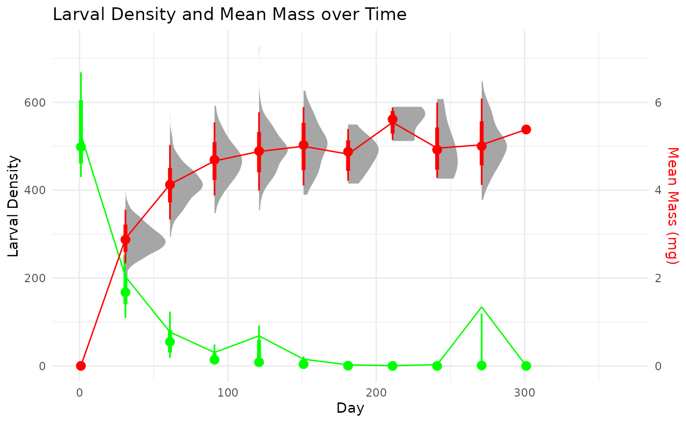

# A few simple examples

## Introduction

The `secpRod` package provides a number of methods to calculate
secondary production of populations, both those with clear cohort
structure and those where cohort structure is not possible to discern.
First, we walk through the available methods using simulated populations
that mimic the data structure of real sampling regimes. The parameters
to create these simulated populations is outlined in companion article,
[“Simulating the sampling of populations”
vignette](https://jimjunker1.github.io/secpRod/articles/sampling-simulation.html).
These simulated populations skip some of the steps of moving from
initial sampling processes (e.g., length to mass conversions, sample
subsetting, etc.) that are often part of the process. More complete
examples that showcase helper functions within `secpRod` that deal with
these processes can be found below in the [“A full example”
vignette](https://jimjunker1.github.io/secpRod/articles/full-example.html).
Here, we just showcase the secondary production methods available.

The methods within the package use two main objects, `sampleInfo` the
sample-level information (e.g., site, date , replicate) and density and
length or mass. An additional dataframe, `taxaInfo` that houses
species-specific information such as length to mass conversions, and
method specific information such as cohort production interval estimates
(CPIs), production:biomass ratios (PBs), and growth equations. The
columns contain information for the calculation of production. These
include, but are not limited to:

- taxonID: a character string that matches the name of taxonID from
  sampleInfo

- massForm: a character string that is coercible to a formula for the
  conversion from length to mass (e.g., `mass~(a*lengthClass^b)`)

- a: numeric variable for the coefficients used in massForm

- b: numeric variable for the coefficients used in massForm

- percAsh: numeric integer 0–100

- method: character string for the method to use. Must be one of the
  following:

  - ‘is’: increment-summation method. This cohort-based method
    calculates interval and annual production, $P$, from field data as
    the sum of all interval production,
    $\sum_{i = 1}^{t}\overline{N}\Delta W$, plus initial biomass,
    $B_{iniital}$:

  $$P = B_{initial} + \sum\limits_{i = 1}^{t}\overline{N}\Delta W$$

  - ‘rs’: removal-summation method is similar to the increment-summation
    method but instead calculates the production *lost* during a
    sampling interval as the product of the decrease in density,
    $\Delta N$ and the mean individual mass, $\overline{W}$ plus the
    increase in biomass, $\Delta B$.

  - ‘sf’: size-frequency method. This non-cohort approach assumes the
    mean size-frequency data from collected samples characterizes the
    mortality, growth and development of an average cohort. The
    densities within size classes are averaged across all sampling dates
    and the decrease in density across sizes classes is calculated
    similar to the *removal-summation* method. This method assumes a
    1-year lifespan. If taxa have an average life span much shorter or
    longer than 1-year, a cohort production interval (CPI) correction
    must be applied. See Benke (1979) or Benke and Huryn (2017) for a
    more complete explanation. The CPI must be provided in the `min.cpi`
    and `max.cpi` variables of the `taxaInfo` object.

  - ‘igr’: instantaneous growth method. This approach is most often
    applied as a noncohort approach, but can also be used for taxa with
    identifiable cohorts. It requires the determination of daily
    instantaneous growth rates, *g_d*, specified in `growthForm`. Growth
    rates can be determined through a number of approaches such as, from
    growth chambers in the field or laboratory, mark-recapture of
    individuals, or statistical regression models. See Huryn and Wallace
    (1986), Morin and Dumont (1994), Benke and Huryn (2017) and the
    citations therein for more examples of these approaches.

  - ‘pb’: production:biomass ratio method. This approach calculates
    production by multiplying annual biomass by a value of
    production:biomass ratio (P:B). The P:B must be supplied in the `pb`
    variable of the `taxaInfo` object.

- growthForm: daily growth rates, *g_d*, to calculate production from
  the instantaneous growth method. This takes the form of a character
  string that is coercible to a formula. This formula is parsed and
  will, if necessary, reference existing information (e.g., size
  information) if variables are included in the formula. The variables
  in the string must match exactly those in the data (e.g., if massValue
  == ‘mass’, ‘mass’ must be in the dataframe). **Warning: this method is
  currently under development to include additional sources of
  environmental data (e.g. temperature). When complete, additional data
  passed to `envData` will also be referenced to predict growth rates.**
  Currently, the tests for this feature are still in development, it
  will not reject any nonsensical values (e.g, negative, NA, or Inf). If
  your equation predicts negative values you may get negative production
  estimates–at least until the `min.growth` feature is implemented.

- min.cpi: integer of the minimum estimated cohort production interval
  for adjusting annual production estimates using the size-frequency
  method

- max.cpi: integer of the maximum estimated cohort production interval
  for adjusting annual production estimates using the size-frequency
  method

- pb: numeric of the production to biomass (PB) ratio for the specific
  taxa. This can take three forms 1) a single value, 2) a vector of
  values the same length as `bootNum`, and 3) a string of a distribution
  to randomly sample, **not** including the `n =` (e.g., ‘rnorm(mean =
  5, sd = 0.5)’, ‘runif(min = 3, max = 8)’). The function will
  automatically sample the `bootNum` values. ***Warning: Currently, you
  must explicitly name the parameters in the distribution call string
  (e.g., mean, sd, min, max). Possible unwanted and unknown things will
  happen otherwise. The tests for this feature are still under
  development, it will not reject any nonsensical values (e.g, negative,
  NA, or Inf). If your distribution samples negative values you will get
  negative production estimates***. At least until the `min.growth`
  feature is implemented.

- min.growth: a minimal growth rate value of *g_d* to assign when
  density is \>0 and growth estimates for a taxon are \<0. *This is
  currently not implemented, but is kept for future use.*

- wrap: logical (or coercible) indicating whether the production
  estimate should wrap the first and last dates to create a full annual
  cycle. If TRUE, this will create an additional sampling interval using
  the mean densities and masses of the first and last sampling events to
  create a full annual data set. The default is FALSE.

- envData: additional information or data to pass to the function. This
  is mainly used to pass environmental data to inform growth rate
  information by included information such as temperature, food
  availability, etc.

- notes: notes for researcher use. This column will be maintained in
  output summaries.

``` r
taxaInfo <- tibble::tibble(
  taxonID = c("sppX"),
  massForm = c("mass~(a*lengthClass^b)*percAsh"),
  # a is NA for this example because we simulated mass growth and don't need to convert from length to mass
  a = c(NA),
  # b is NA for this example because we simulated mass growth and don't need to convert from length to mass
  b = c(NA),
  # percAsh is NA for this example because we simulated mass growth and don't need to convert from length to mass
  percAsh = c(NA),
  # method can accept one or more values. This allow comparisons among different methods.
  method = 'is',#list(c("is","pb","sf")),
  growthForm = c("g_d ~ exp(log(0.01) - 0.25*log(mass) + 0.01*log(tempC))"),
  min.cpi = c(335),
  max.cpi = c(365),
  pb = c("runif(min = 3, max = 8)"),
  min.growth = c(0.001),
  wrap = FALSE,
  notes = c("This is here for your use. No information will be used, but this column will be maintained in some summaries. See *** for more information.")
)
```

## A multi-method comparison with simulated data

First, we load and visualize the simulated cohort data set, which
contains a single species and follows the progression of density and the
distribution of individual masses through it life cycle.

The data set is available within the `secpRod` package with:

``` r
data('singleCohortSim', package = 'secpRod')
```

The `sampleInfo` for this species includes:

    #> # A tibble: 10 × 5
    #>    taxonID dateID repID  mass density
    #>    <chr>    <dbl> <int> <dbl>   <dbl>
    #>  1 sppX         1     1 0.001     463
    #>  2 sppX         1     2 0.001     458
    #>  3 sppX         1     3 0.001     479
    #>  4 sppX         1     4 0.001     422
    #>  5 sppX         1     5 0.001     639
    #>  6 sppX         1     6 0.001     575
    #>  7 sppX         1     7 0.001     518
    #>  8 sppX         1     8 0.001     677
    #>  9 sppX         1     9 0.001     566
    #> 10 sppX         1    10 0.001     468

this object can be a data.frame (or coercible) or a tibble (if list-cols
are used) which contains the following columns:

- taxonID: (required) a character string that matches the name of
  taxonID from taxaInfo

- dateID: a column representing the date identifier. This can be a
  julian date (as in this case) or a recognized date object (e.g., Date
  class, POSIXct, etc.)

- repID: a column representing the replicate identifier for the length
  and mass data

- density: (or column name specified in `abunValue`) organism density of
  each length or mass class in the replicate

- mass: (or column name specified in `massValue`) individual mass. This
  is the mass class with a corresponding density. The density of each
  mass class sums to the total sample density.

These columns names above are the default column names. The exact names
of these some columns (and additional optional columns such as length
information) can be modified within the
[`calc_production()`](https://jimjunker1.github.io/secpRod/reference/calc_production.md)
function. See [“A full
example”](https://jimjunker1.github.io/secpRod/articles/full-example.html)
for more information on customizing this main function further.

We can summarize and visualize this data set further.

``` r

summary_stats <- singleCohortSim %>%
  dplyr::mutate(density = sum(density, na.rm = TRUE), .by = c('taxonID','dateID','repID')) %>% 
  dplyr::summarise(
    massMean = mean(mass, na.rm = TRUE),
    massSD= sd(mass, na.rm = TRUE),
    larvalDensityMean = mean(density, na.rm = TRUE), .by = 'dateID'
  )

sim_plot = 
ggplot(summary_stats, aes(x = dateID)) +
  stat_halfeye(data = singleCohortSim %>% 
                 dplyr::summarise(density = sum(density, na.rm = TRUE), .by = c('taxonID','dateID','repID')), aes(x = dateID, y = density),
               color = 'green')+
  stat_halfeye(data = singleCohortSim, aes(x = dateID, y = mass*100),
               color = 'red')+
  geom_path(aes(y = larvalDensityMean), color = 'green') +
  geom_path(aes(y = massMean * 100), color = 'red') +
  scale_y_continuous(
    name = "Larval Density",
    sec.axis = sec_axis(~./100, name = "Mean Mass (mg)"),
    
  ) +
  scale_x_continuous(limits = c(0,365))+
  theme_minimal() +
  labs(title = "Larval Density and Mean Mass over Time", x = "Day")+
  theme(axis.title.y.right = element_text(color = 'red'))
```



We use this data set to calculate secondary production with different
methods. First, we start with cohort-based methods. The main function of
`secpRod` is
[`calc_production()`](https://jimjunker1.github.io/secpRod/reference/calc_production.md)
which is the workhorse function that will estimate population and/or
community production.

To apply it to our single species example, we input the sample
information and taxa information along with how many bootstraps we would
like, as:

``` r

calc_production(
  taxaSampleListMass = singleCohortSim,
  taxaInfo = taxaInfo,
  bootNum = 10,
  taxaSummary = TRUE,
  massValue = 'mass',
  abunValue = 'density'
)
```

This will output an object with bootstrapped estimates as well as a
summary of the samples. It has a simple structure:

1.  P.boots–vectors of bootstrapped estimates of annual production,
    annual mean biomass, and annual mean abundance.

2.  taxaSummary–is a summary of the sampled data, including estimated
    production, sampling event summaries of density, biomass, and
    production (if applicable). This can be turned off by setting
    `taxaSummary` to `FALSE`.

Below, we walk through each of the available methods using this
simulated population. For further details on these methods and their
calculations, see (**benke2007?**).

### Increment-summation

``` r

set.seed(1312)
calc_production(
  taxaSampleListMass = singleCohortSim,
  taxaInfo = taxaInfo,
  bootNum = 1e1,
  taxaSummary = TRUE,
  massValue = 'mass',
  abunValue = 'density'
)
#> $P.boots
#>            [,1]     [,2]     [,3]     [,4]     [,5]     [,6]     [,7]    
#> P.ann.samp 2326.716 1948.697 1972.095 2036.732 2289.194 1911.34  2054.362
#> B.ann.samp 121.7319 98.44109 112.0241 111.5616 111.0987 124.9283 119.6349
#> N.ann.samp 81.54545 76.73636 75.85455 79.63636 80.76364 81.43636 81.39091
#>            [,8]     [,9]     [,10]   
#> P.ann.samp 2090.462 1538.009 1659.261
#> B.ann.samp 100.207  82.95062 88.37525
#> N.ann.samp 80.88182 67.33636 76.12727
#> 
#> $taxaSummary
#> $taxaSummary$taxonID
#> [1] "sppX"
#> 
#> $taxaSummary$method
#> [1] "is"
#> 
#> $taxaSummary$P.ann.samp
#> [1] 1965.248
#> 
#> $taxaSummary$P.uncorr.samp
#> NULL
#> 
#> $taxaSummary$pb
#> [1] 19.01809
#> 
#> $taxaSummary$meanN
#> [1] 76.81818
#> 
#> $taxaSummary$meanB
#> [1] 103.3357
#> 
#> $taxaSummary$meanIndMass
#> [1] 1.345199
#> 
#> $taxaSummary$datesInfo
#>    dateID  N density_mean density_sd biomass_mean   biomass_sd
#> 1       1 10        526.5 84.7312746       0.5265   0.08473127
#> 2      31 10        188.3 59.5110634     545.8428 174.77142887
#> 3      61 10         59.7 34.3642256     246.7510 141.80435903
#> 4      91 10         18.2 15.8591018      84.9913  74.46818703
#> 5     121 10         25.8 35.2445425     125.7648 171.92585860
#> 6     151 10          7.0  8.2192187      34.9949  41.35086763
#> 7     181 10          1.4  1.7126977       6.7490   8.13225550
#> 8     211 10          0.3  0.6749486       1.6633   3.68722961
#> 9     241 10          1.1  1.9692074       5.4528   9.50699300
#> 10    271 10         16.6 47.2915308      83.4182 237.84375664
#> 11    301 10          0.1  0.3162278       0.5382   1.70193784
```

### Size-frequency

``` r
taxaInfo <- tibble::tibble(
  taxonID = c("sppX"),
  massForm = c("mass~(a*lengthClass^b)*percAsh"),
  # a is NA for this example because we simulated mass growth and don't need to convert from length to mass
  a = c(NA),
  # b is NA for this example because we simulated mass growth and don't need to convert from length to mass
  b = c(NA),
  # percAsh is NA for this example because we simulated mass growth and don't need to convert from length to mass
  percAsh = c(NA),
  # method can accept one or more values. This allow comparisons among different methods.
  method = 'sf',#list(c("is","pb","sf")),
  growthForm = c("g_d ~ exp(log(0.01) - 0.25*log(mass) + 0.01*log(tempC))"),
  min.cpi = c(290),
  max.cpi = c(310),
  pb = c("runif(min = 3, max = 8)"),
  min.growth = c(0.001),
  wrap = FALSE,
  notes = c("This is here for your use. No information will be used, but this column will be maintained in some summaries. See *** for more information.")
)

set.seed(1312)
calc_production(
  taxaSampleListMass = singleCohortSim,
  taxaInfo = taxaInfo,
  bootNum = 2,
  taxaSummary = TRUE,
  massValue = 'mass',
  abunValue = 'density'
)
#> $P.boots
#>               [,1]     [,2]    
#> P.ann.samp    5181.701 5010.692
#> P.uncorr.samp 4131.164 4008.554
#> B.ann.samp    121.7319 98.44109
#> N.ann.samp    81.54545 76.73636
#> 
#> $taxaSummary
#> $taxaSummary$taxonID
#> [1] "sppX"
#> 
#> $taxaSummary$method
#> [1] "sf"
#> 
#> $taxaSummary$P.ann.samp
#> [1] 6230.138
#> 
#> $taxaSummary$P.uncorr.samp
#> [1] 5120.662
#> 
#> $taxaSummary$cpi
#> [1] 300
#> 
#> $taxaSummary$pb
#> [1] 60.29028
#> 
#> $taxaSummary$meanN
#> [1] 76.81818
#> 
#> $taxaSummary$meanB
#> [1] 103.3357
#> 
#> $taxaSummary$meanIndMass
#> [1] 1.345199
#> 
#> $taxaSummary$datesInfo
#>    dateID  N density_mean density_sd biomass_mean   biomass_sd
#> 1       1 10        526.5 84.7312746       0.5265   0.08473127
#> 2      31 10        188.3 59.5110634     545.8428 174.77142887
#> 3      61 10         59.7 34.3642256     246.7510 141.80435903
#> 4      91 10         18.2 15.8591018      84.9913  74.46818703
#> 5     121 10         25.8 35.2445425     125.7648 171.92585860
#> 6     151 10          7.0  8.2192187      34.9949  41.35086763
#> 7     181 10          1.4  1.7126977       6.7490   8.13225550
#> 8     211 10          0.3  0.6749486       1.6633   3.68722961
#> 9     241 10          1.1  1.9692074       5.4528   9.50699300
#> 10    271 10         16.6 47.2915308      83.4182 237.84375664
#> 11    301 10          0.1  0.3162278       0.5382   1.70193784
```

## Production:Biomass ratio

``` r
taxaInfo <- tibble::tibble(
  taxonID = c("sppX"),
  massForm = c("mass~(a*lengthClass^b)*percAsh"),
  # a is NA for this example because we simulated mass growth and don't need to convert from length to mass
  a = c(NA),
  # b is NA for this example because we simulated mass growth and don't need to convert from length to mass
  b = c(NA),
  # percAsh is NA for this example because we simulated mass growth and don't need to convert from length to mass
  percAsh = c(NA),
  # method can accept one or more values. This allow comparisons among different methods.
  method = 'pb',#list(c("is","pb","sf")),
  growthForm = c("g_d ~ exp(log(0.01) - 0.25*log(mass) + 0.01*log(tempC))"),
  min.cpi = c(335),
  max.cpi = c(365),
  pb = c("runif(min = 3, max = 8)"),
  min.growth = c(0.001),
  wrap = FALSE,
  notes = c("This is here for your use. No information will be used, but this column will be maintained in some summaries. See *** for more information.")
)

set.seed(1312)
calc_production(
  taxaSampleListMass = singleCohortSim,
  taxaInfo = taxaInfo,
  bootNum = 1e1,
  taxaSummary = TRUE,
  massValue = 'mass',
  abunValue = 'density'
)
#> $P.boots
#>            [,1]     [,2]     [,3]     [,4]     [,5]     [,6]     [,7]    
#> P.ann.samp 467.5511 609.2463 798.3784 695.2885 663.7908 834.8366 494.0535
#> B.ann.samp 121.7319 98.44109 112.0241 111.5616 111.0987 124.9283 119.6349
#> N.ann.samp 81.54545 76.73636 75.85455 79.63636 80.76364 81.43636 81.39091
#>            [,8]     [,9]     [,10]   
#> P.ann.samp 582.7689 401.9146 439.8044
#> B.ann.samp 100.207  82.95062 88.37525
#> N.ann.samp 80.88182 67.33636 76.12727
#> 
#> $taxaSummary
#> $taxaSummary$taxonID
#> [1] "sppX"
#> 
#> $taxaSummary$method
#> [1] "pb"
#> 
#> $taxaSummary$P.ann.samp
#> [1] 404.9974
#> 
#> $taxaSummary$pb
#> [1] 3.91924
#> 
#> $taxaSummary$meanN
#> [1] 76.81818
#> 
#> $taxaSummary$meanB
#> [1] 103.3357
#> 
#> $taxaSummary$meanIndMass
#> [1] 1.345199
#> 
#> $taxaSummary$datesInfo
#>    dateID  N density_mean density_sd biomass_mean   biomass_sd
#> 1       1 10        526.5 84.7312746       0.5265   0.08473127
#> 2      31 10        188.3 59.5110634     545.8428 174.77142887
#> 3      61 10         59.7 34.3642256     246.7510 141.80435903
#> 4      91 10         18.2 15.8591018      84.9913  74.46818703
#> 5     121 10         25.8 35.2445425     125.7648 171.92585860
#> 6     151 10          7.0  8.2192187      34.9949  41.35086763
#> 7     181 10          1.4  1.7126977       6.7490   8.13225550
#> 8     211 10          0.3  0.6749486       1.6633   3.68722961
#> 9     241 10          1.1  1.9692074       5.4528   9.50699300
#> 10    271 10         16.6 47.2915308      83.4182 237.84375664
#> 11    301 10          0.1  0.3162278       0.5382   1.70193784
```

## Instantaneous growth rate (IGR)

The instantaneous growth rate method allows for additional data to be
passed to the production function. This additional data can inform
growth rates. See (#Introduction) above for more details on the
structure of this variable. In this example, we showcase the use of a
growth equation that gives reasonable mass-dependence of growth rates
and an additional variable `tempC` which is meant to represent
environmental temperature. We fix temperature in this example just to
showcase functionality when a growth equation uses a variable found in
the main sample data object `taxaSampleListMass` and in the additional
environmental data provided in `envData`.

``` r
taxaInfo <- tibble::tibble(
  taxonID = c("sppX"),
  massForm = c("mass~(a*lengthClass^b)*percAsh"),
  # a is NA for this example because we simulated mass growth and don't need to convert from length to mass
  a = c(NA),
  # b is NA for this example because we simulated mass growth and don't need to convert from length to mass
  b = c(NA),
  # percAsh is NA for this example because we simulated mass growth and don't need to convert from length to mass
  percAsh = c(NA),
  # method can accept one or more values. This allow comparisons among different methods.
  method = "igr",#list(c("is","pb","sf","igr")),
  growthForm = c("g_d ~ exp(log(0.01) - 0.25*log(mass) + 0.07*log(tempC))"),
  min.cpi = c(335),
  max.cpi = c(365),
  pb = c("runif(min = 3, max = 8)"),
  min.growth = c(0.001),
  wrap = TRUE,
  notes = c("This is here for your use. No information will be used, but this column will be maintained in some summaries. See *** for more information.")
)

envData <- data.frame(
  dateID = unique(singleCohortSim$dateID),
  tempC = rep(20, length(unique(singleCohortSim$dateID)))
)

set.seed(1312)
calc_production(
  taxaSampleListMass = singleCohortSim,
  taxaInfo = taxaInfo,
  bootNum = 1e1,
  taxaSummary = TRUE,
  massValue = 'mass',
  abunValue = 'density',
  envData = envData
)
#> $P.boots
#>            [,1]     [,2]     [,3]     [,4]     [,5]     [,6]     [,7]    
#> P.ann.samp 412.1488 313.9167 349.2252 397.4242 340.9156 400.9898 363.3421
#> B.ann.samp 111.6767 90.30495 102.7093 102.2871 101.9077 114.5846 109.6877
#> N.ann.samp 96.58333 92.77917 90.0625  95.29167 96.36667 96.7875  97.04167
#>            [,8]     [,9]     [,10]   
#> P.ann.samp 313.6778 255.3042 295.9159
#> B.ann.samp 91.92501 76.0808  81.0566 
#> N.ann.samp 97.90833 82.03333 93.31667
#> 
#> $taxaSummary
#> $taxaSummary$taxonID
#> [1] "sppX"
#> 
#> $taxaSummary$method
#> [1] "igr"
#> 
#> $taxaSummary$P.ann.samp
#> [1] 332.5635
#> 
#> $taxaSummary$pb
#> [1] 3.50921
#> 
#> $taxaSummary$meanN
#> [1] 92.35833
#> 
#> $taxaSummary$meanB
#> [1] 94.76876
#> 
#> $taxaSummary$meanIndMass
#> [1] 1.026099
#> 
#> $taxaSummary$datesInfo
#>    dateID  N density_mean density_sd biomass_mean   biomass_sd   production
#> 1       1 10       526.50 84.7312746      0.52650   0.08473127   1.09544791
#> 2      31 10       188.30 59.5110634    545.84280 174.77142887 154.60898859
#> 3      61 10        59.70 34.3642256    246.75100 141.80435903  63.96774221
#> 4      91 10        18.20 15.8591018     84.99130  74.46818703  21.37283709
#> 5     121 10        25.80 35.2445425    125.76480 171.92585860  34.76369606
#> 6     151 10         7.00  8.2192187     34.99490  41.35086763  10.81326327
#> 7     181 10         1.40  1.7126977      6.74900   8.13225550   3.36869851
#> 8     211 10         0.30  0.6749486      1.66330   3.68722961   2.00462640
#> 9     241 10         1.10  1.9692074      5.45280   9.50699300   3.37635326
#> 10    271 10        16.60 47.2915308     83.41820 237.84375664  34.32263491
#> 11    301 10         0.10  0.3162278      0.53820   1.70193784   2.78907276
#> 12    365 NA       271.55 97.0354460     41.97235 237.84377173   0.08009419
```

## References

Benke, A. C. 1979. [A modification of the Hynes method for estimating
secondary production with particular significance for multivoltine
populations](https://doi.org/10.4319/lo.1979.24.1.0168). Limnology and
Oceanography 24:168–171.

Benke, A. C., and A. D. Huryn. 2017. [Secondary Production and
Quantitative Food
Webs](https://doi.org/10.1016/B978-0-12-813047-6.00013-9). Pages 235–254
Methods in Stream Ecology. 3rd edition. Elsevier.

Huryn, A. D., and J. B. Wallace. 1986. [A method for obtaining in situ
growth rates of larval Chironomidae (Diptera) and its application to
studies of secondary
production](https://doi.org/10.4319/lo.1986.31.1.0216). Limnology and
Oceanography 31:216–221.

Morin, A., and P. Dumont. 1994. [A Simple Model to Estimate Growth Rate
of Lotic Insect Larvae and Its Value for Estimating Population and
Community Production](https://doi.org/10.2307/1467365). Journal of the
North American Benthological Society 13:357–367.
